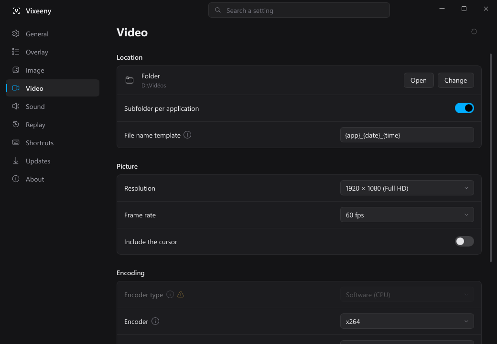

<div align="center">


# Vixeeny

Screenshots and screen recording for Windows. Free and open source.

[](https://github.com/Xantoom/Vixeeny/releases/latest)
[](#install)
[](LICENSE)

[**Download**](https://github.com/Xantoom/Vixeeny/releases/latest) · [Limitations](docs/LIMITATIONS.md) · [Help test](docs/BETA.md) · [Contribute](CONTRIBUTING.md)

<br>



</div>

<br>

Vixeeny sits in the system tray and waits for a shortcut. Nothing shows on screen until you press
one.

## Features

<table>
<tr><td><b>Capture</b></td><td>Region · Window · Screen · All monitors · Scrolling page</td></tr>
<tr><td><b>Image formats</b></td><td>PNG · JPEG · WebP · AVIF · JPEG XL, HDR kept or converted to SDR</td></tr>
<tr><td><b>Editor</b></td><td>Arrows · Shapes · Text · Highlighter · Numbered steps · Blur · Pixelate</td></tr>
<tr><td><b>Text recognition</b></td><td>Copy the text of any selection</td></tr>
<tr><td><b>Video</b></td><td>NVIDIA NVENC · AMD AMF · Intel QuickSync · Processor, in H.264 · HEVC · AV1</td></tr>
<tr><td><b>Audio</b></td><td>Game, microphone and single programs on separate tracks</td></tr>
<tr><td><b>Replay</b></td><td>Keeps the last minutes, saved with one shortcut, trimmed before saving</td></tr>
<tr><td><b>Games</b></td><td>One folder per game · Works in games started as administrator</td></tr>
<tr><td><b>Updates</b></td><td>In the background · Signature checked · Rolled back if the new version fails</td></tr>
</table>

## Install

Download `Vixeeny-<version>-setup.exe`, or the portable `.zip`, from the
[releases page](https://github.com/Xantoom/Vixeeny/releases/latest).

The installer asks who Vixeeny is for:

- **All accounts on this PC** (the default): installed in Program Files, with the administrator's
  rights granted once during the install. Shortcuts and captures then also work in programs
  started as administrator, such as some games.
- **My account only**: installed in your own folders, without these rights. Settings → General
  can move it to Program Files later.

> [!NOTE]
> The installer is not signed with a paid certificate, so SmartScreen may warn the first time:
> **More info → Run anyway**. Updates are verified with [minisign](packaging/minisign.pub).

## Build from source

Vixeeny is written in Rust, with a [Slint](https://slint.dev) interface and FFmpeg for video.

```bash
cargo fmt --check && cargo clippy --workspace --all-targets -- -D warnings && cargo test --workspace
```

Release builds need the pinned native libraries (`cargo xtask build-native`). See
[CONTRIBUTING.md](CONTRIBUTING.md) and [docs/ARCHITECTURE.md](docs/ARCHITECTURE.md).

## License

[GPL-3.0-or-later](LICENSE). The licences of the bundled libraries are listed in
`THIRD-PARTY-LICENSES.txt` inside every package.
